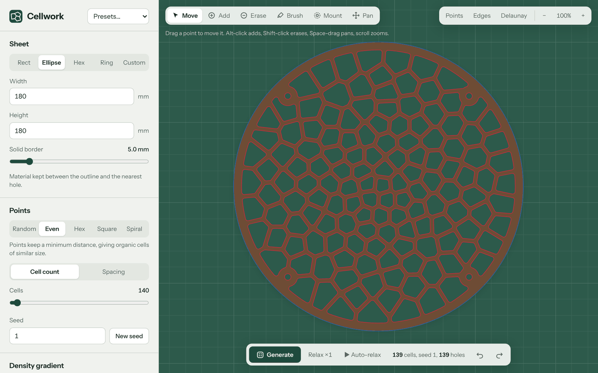
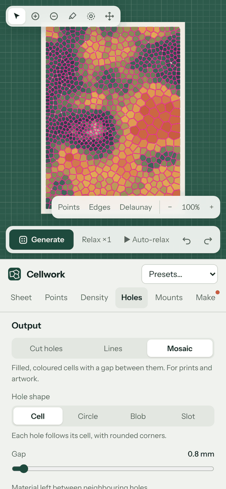

# Cellwork

by Chris Spatschek

Design Voronoi patterns you can actually make. Cellwork turns points into cells, shapes them
with gradients and a paint brush, turns them into cut-ready holes, checks the result for
thin webs and undersized holes, and exports real-size files for laser cutters, CNC routers
and pen plotters, or artwork for print.

It is a single, self-contained HTML file. No install, no account, no server, no tracking:
everything runs in your browser and nothing you load ever leaves your device.

<p>
  
  
</p>

## Use it

- **Online:** open the GitHub Pages site for this repository (see [Publishing](#publishing-on-github-pages)).
- **Offline:** download `index.html` and open it in any current browser. It works without a connection.

## Features

**Points**
- Five layouts: Random, Even (Poisson disk), Hex, Square and Spiral (golden angle).
- Set the number of cells or the spacing in millimetres, plus jitter and a seed.
- Lloyd relaxation (one step, a set number per generate, or animated), weighted so gradients survive.

**Density**
- Gradients: linear, radial, noise, or an image (dark areas get small cells).
- Brush: paint areas denser or sparser, or paint areas to keep solid for logos, labels, hinges or fixings.

**Sheet**
- Rectangle with rounded corners, ellipse, hexagon, ring, or your own SVG outline, including holes in it.
- Solid border between the outline and the pattern.

**Output**
- Cut holes with a set web width and corner rounding, as cells, circles, blobs or slots (slots aligned to make flexible sheets).
- Webs that thicken where cells are large, for stronger parts.
- Lines (each edge once) for plotters and engraving, or Mosaic with seven colour palettes.
- Mounting holes: four corner holes in one click or placed by hand, each with a solid ring.

**Making it**
- Laser cutter or CNC router profile.
- Highlights webs thinner than your minimum and holes narrower than the cut or bit.
- Estimates cut length and job time from your speeds, pierce or plunge time and passes.
- Optional kerf compensation (laser) or tool-centre paths (CNC) in the exported files.

**Export**
- Laser SVG at real size in millimetres, with holes in red, mounting holes in green and the outline in blue, so you can order the cuts.
- DXF (R12, millimetres) for Fusion and other CAD software.
- Artwork SVG, PNG at 150, 300 or 600 dpi, and project files that keep every setting and hand-placed point.

**Editing**
- Move, add and erase points; drag mounting holes; undo and redo.
- Zoom and pan with mouse, trackpad or pinch.
- On phones the settings sit in tabs (Sheet, Points, Density, Holes, Mounts, Make); swipe to switch.

### Keyboard shortcuts

| Key | Action |
|---|---|
| G | Generate |
| R | Relax one step |
| F | Fit to view |
| V / A / E / B / M / H | Move, Add, Erase, Brush, Mount, Pan tools |
| Space + drag | Pan |
| Alt-click / Shift-click | Add / erase a point |
| Ctrl/Cmd + Z, Ctrl/Cmd + Shift + Z | Undo, redo |

### Tips for cutting

- Set **Minimum web** to about the material thickness for plywood, and keep **Highlight problems** on.
- Laser: measure your kerf with a test cut and turn on **Compensate kerf in exports** for press-fit or exact-size parts.
- CNC: enter the bit diameter. Inside corners are rounded to the bit radius automatically.
- Export at real size and check the scale on import; LightBurn and Inkscape read the millimetre size from the SVG.

## Project structure

```
index.html                 The app. Generated by build.py; this is the file you publish.
src/index.template.html    Source of the app (HTML, CSS, JavaScript). Edit this.
vendor/                    Pinned third-party libraries, inlined at build time (see vendor/README.md)
fonts/                     Instrument Sans (Latin subset, WOFF2)
licenses/                  Licence texts of all bundled components (also embedded in index.html)
build.py                   Inlines libraries and font, writes the Content Security Policy
docs/                      Screenshots for this README
```

## Building

Requires Python 3 and nothing else.

```sh
python3 build.py           # writes index.html
python3 build.py --check   # exits with an error if index.html is out of date
```

Always edit `src/index.template.html` and rebuild. The build computes SHA-256 hashes of the
inline script and style blocks for the Content Security Policy, so hand edits to `index.html`
stop the page from running.

## Publishing on GitHub Pages

1. Push this repository to GitHub.
2. Go to **Settings → Pages**, choose **Deploy from a branch**, branch `main`, folder `/ (root)`.
3. The app will be available at `https://<your-user>.github.io/<repository>/`.

The `.nojekyll` file makes Pages serve the files as they are.

## Security and privacy

Cellwork makes no network requests, stores nothing in the browser, and has no analytics.
Files you open are processed locally. A strict Content Security Policy blocks all external
resources and any script that is not part of the app. Imported SVGs and project files are
treated as untrusted and sanitised. Details and how to report a problem: [SECURITY.md](SECURITY.md).

## Licence

Copyright © 2026 Chris Spatschek. Cellwork is released under the [MIT License](LICENSE). It bundles d3-delaunay and Delaunator
(ISC), robust-predicates (Unlicense), Clipper JS with JSBN (Boost Software License 1.0 and the JSBN licence) and the
Instrument Sans typeface (SIL Open Font License 1.1). See
[THIRD_PARTY_NOTICES.md](THIRD_PARTY_NOTICES.md). All licence texts are also embedded in
`index.html`, so the single file can be shared on its own.
